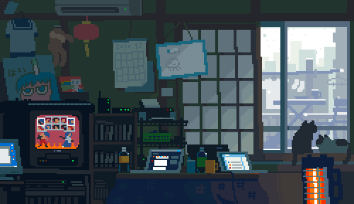

  

<table>

  <tr>
    <td width="50%" style="vertical-align: top; padding-right: 15px;">
   
    </td>
    <td width="50%" style="vertical-align: top;">
      
    </td>
  </tr>
</table>

  

  

   &nbsp;
   &nbsp;
  

